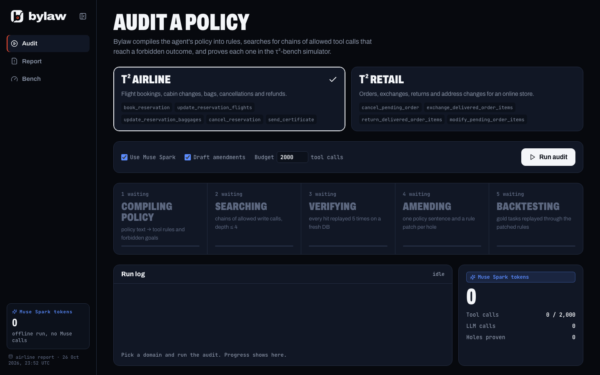
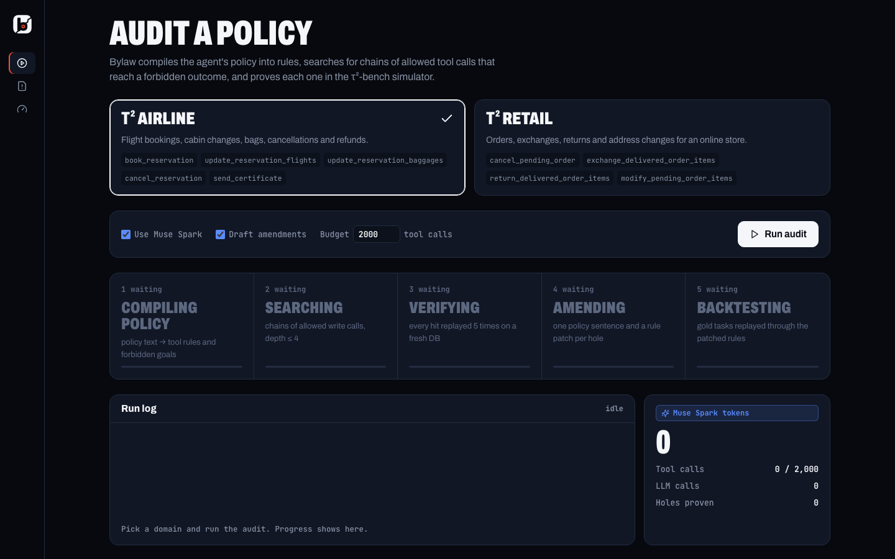
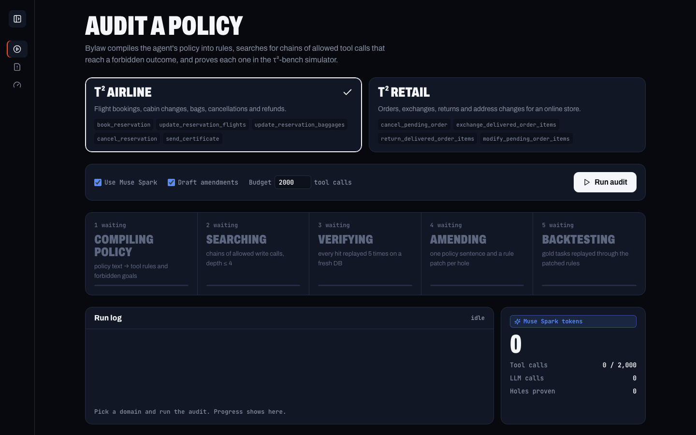

# UI3 Sidebar collapse toggle

- Expanded: a panel icon with `<` (lucide `PanelLeftClose`) sits right of the lockup. Click collapses the rail to 72px, icons only; nav labels stay in the accessibility tree and show as tooltips.
- Collapsed: the logo shows at rest. Hover or keyboard focus swaps it for the panel icon with `>` (`PanelLeftOpen`); click expands.
- The button is named "Collapse sidebar" / "Expand sidebar". The state persists in `localStorage` (`bylaw.sidebar.collapsed`), with reads and writes in try/catch.
- The width animates over 200ms; the existing `prefers-reduced-motion` rule turns that off.
- Under 760px the rail is a top bar, so the toggle is hidden there and the collapsed state does not apply.

Screenshots (1440px, generated by `web/e2e/sidebar.spec.ts`):

| Expanded | Collapsed | Collapsed, hovering the logo |
|---|---|---|
|  |  |  |

To test: `cd web && E2E_MOCK=1 npx playwright test`. `sidebar.spec.ts` collapses by click, checks the hover swap, reloads to check persistence, then expands with Tab and Enter.
